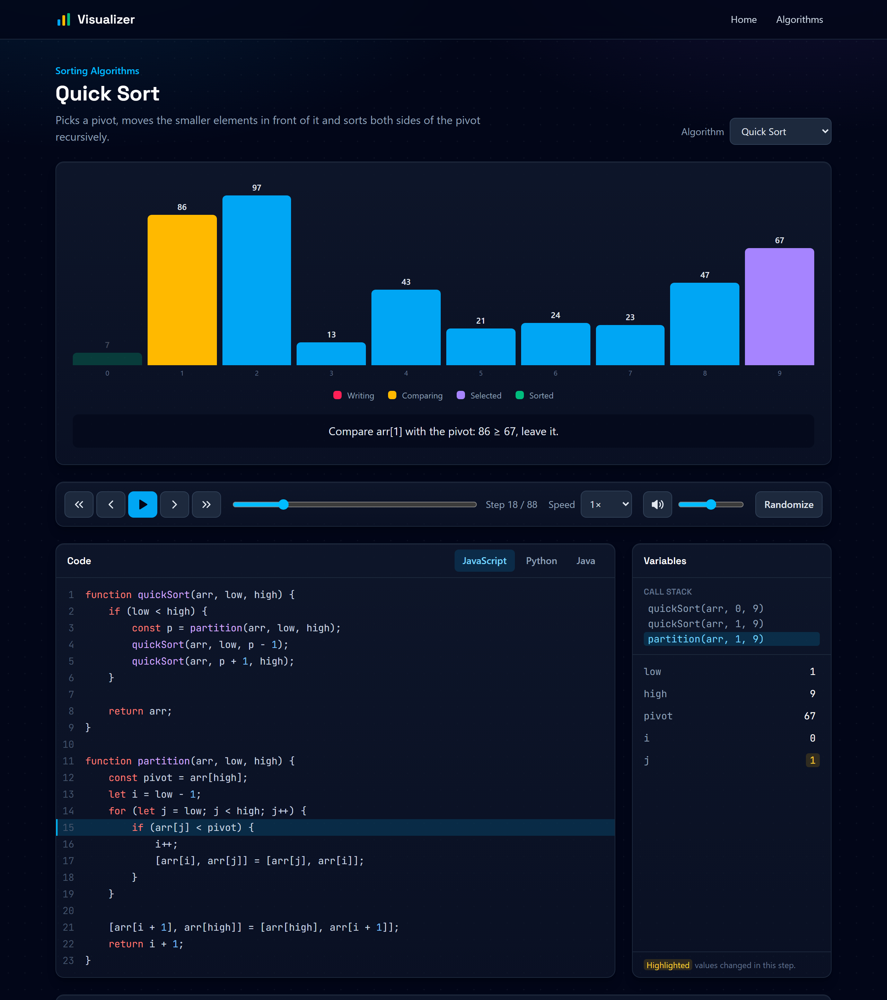

<div align="center">

# Visualizer

**See what your code does, step by step.**

Visualizer animates algorithms and highlights the exact line of code that runs at every step,<br>
so you can connect the idea behind an algorithm with the code that implements it.

</div>



## Why Visualizer?

Reading about an algorithm tells you *what* it does. Watching it run shows you *how*.

Many of us understand the logic behind an algorithm but lose track of which line of code runs when.
Visualizer puts the animation, the code and the variables side by side, so you can follow every single step.
It is built for visual learners and for anyone who wants to really see an algorithm at work.

## Features

- **Step-by-step playback** – play, pause, step forwards and backwards, scrub through the whole run and change the speed from 0.25× to 4×. Keyboard: <kbd>Space</kbd>, <kbd>←</kbd>, <kbd>→</kbd>.
- **Live code highlighting** – the line that runs right now is highlighted, in **JavaScript**, **Python** or **Java**.
- **Variables and call stack** – the current value of every variable, with changes highlighted. Recursive algorithms also show their call stack.
- **Sound effects** – every action (compare, write, select) has its own sound and a short melody plays at the end. Mute it or change the volume in the controls.
- **Explanations** – how each algorithm works, its time and space complexity and its properties.
- **Own URL for every algorithm** – e.g. `/sortingAlgorithms/quicksort`, ready to bookmark and share.

## Algorithms

| Category  | Algorithm            | Average time | Extra space |
| --------- | -------------------- | ------------ | ----------- |
| Sorting   | Bubble Sort          | O(n²)        | O(1)        |
| Sorting   | Selection Sort       | O(n²)        | O(1)        |
| Sorting   | Insertion Sort       | O(n²)        | O(1)        |
| Sorting   | Merge Sort           | O(n log n)   | O(n)        |
| Sorting   | Quick Sort           | O(n log n)   | O(log n)    |
| Sorting   | Heap Sort            | O(n log n)   | O(1)        |
| Searching | Binary Search        | O(log n)     | O(1)        |
| Graph     | Breadth-First Search | O(V + E)     | O(V)        |
| Graph     | Depth-First Search   | O(V + E)     | O(V)        |
| Graph     | Topological Sort     | O(V + E)     | O(V)        |
| Graph     | Dijkstra's Algorithm | O(V²)        | O(V)        |

More algorithms are planned.

## Getting started

Requirements: [Node.js](https://nodejs.org) 22.12 or newer.

```bash
npm install
npm run dev
```

Then open <http://localhost:5173>. The API runs on port 3000 and Vite forwards `/api` requests to it.

| Command             | What it does                                                     |
| ------------------- | ---------------------------------------------------------------- |
| `npm run dev`       | Starts the backend and the frontend in development mode          |
| `npm test`          | Runs all tests                                                   |
| `npm run typecheck` | Type-checks all workspaces                                       |
| `npm run build`     | Builds the backend and the frontend                              |
| `npm start`         | Serves the built app and the API on port 3000 (`PORT` to change) |

## Tech stack

- **Frontend** – TypeScript, Vite, Tailwind CSS and highlight.js, without a UI framework
- **Fonts** – Space Grotesk and JetBrains Mono, self-hosted with Fontsource
- **Backend** – Node.js, Express and TypeScript
- **Tests** – Vitest and Supertest

## Project structure

```
shared/      Types shared by the frontend and the backend (the API contract)
backend/     Express API, algorithm content lives in backend/data as JSON
frontend/    The web app: step generators, visualizers, components and pages
```

Each algorithm is implemented once in TypeScript and records every step it takes. The JSON data maps
those steps to the matching lines of the JavaScript, Python and Java code, so a single implementation
drives the highlighting in every language. [docs.md](docs.md) explains the architecture in detail.

## Contributing

Contributions are welcome! [docs.md](docs.md#adding-an-algorithm) will walk you through the `how` step by step.

Before opening a pull request, please run `npm test` and `npm run typecheck`.
The code style uses tabs with a width of 4 (see [.editorconfig](.editorconfig)).
